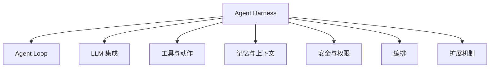
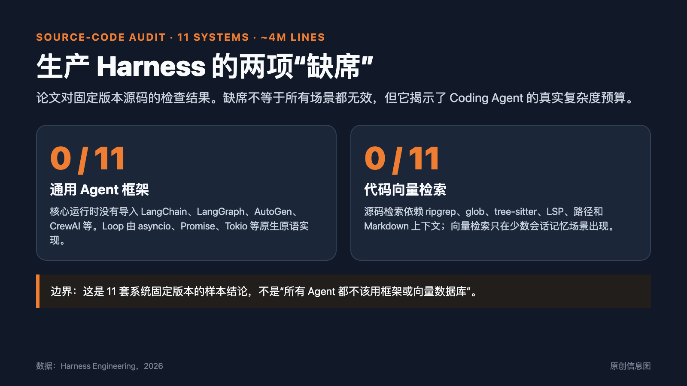
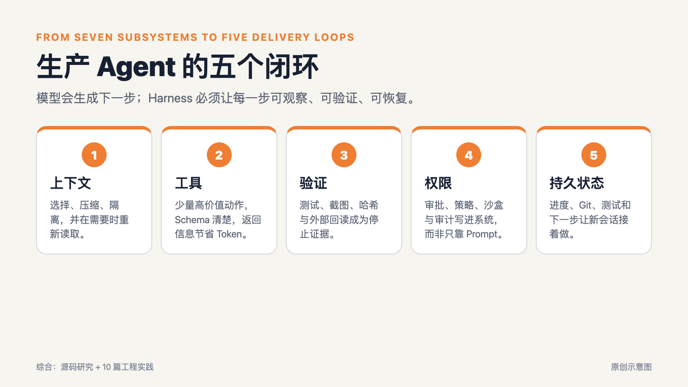
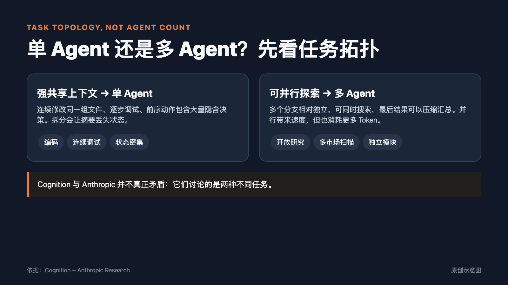
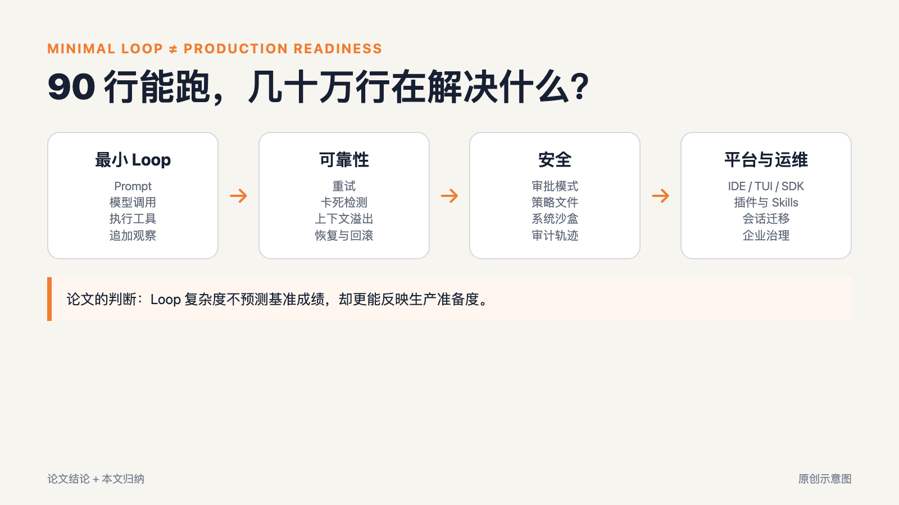
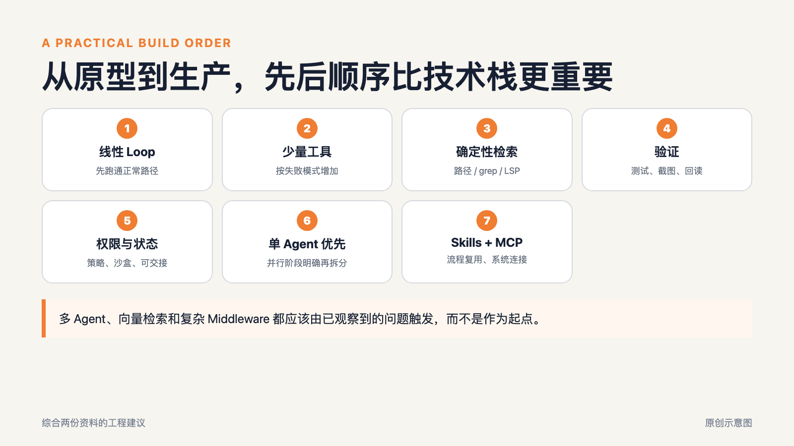

# 审了 400 万行源码，再读 10 篇 Agent 工程实践：框架不是核心，闭环才重要

过去两年，做 Agent 最常见的问题之一是：应该选哪个框架？LangChain、LangGraph、AutoGen，还是自己写？

一份 83 页的新研究给出了一个出人意料的答案。研究者解剖了 Claude Code、Codex CLI、Gemini CLI、OpenHands、OpenCode、OpenClaw 等 11 套生产系统，检查约 400 万行 Python、TypeScript 和 Rust 代码。在这些固定版本里，他们没有在任何一套核心运行时里找到通用 Agent 框架，也没有发现任何系统用向量数据库检索代码。

这不是说框架和向量数据库没有价值，也不是针对所有 Agent 的普遍定律。它说明了一件更具体的事：在这批会修改真实文件、运行命令、跨会话工作并承担风险的生产系统里，工程重点已经从“如何快速搭出 Agent”转向“如何让它在失败后还能继续、在完成后能够证明、在获得权限时不越界”。轻量工作流、一次性任务和非结构化知识检索，仍可能从框架或向量数据库中受益。

把这份源码研究与 Lilian Weng、Anthropic、Cognition、Manus、Simon Willison、Hamel Husain 的 10 篇工程文章放在一起看，结论很清楚：

> 模型决定能力上限，Harness 决定这些能力能否变成稳定交付。竞争焦点已经落到一个更具体的问题：上下文、工具、验证、权限和持久状态能否形成闭环。

*图 1：根据 Barbaste 等人的七子系统定义重新绘制。*

## Harness 到底是什么

一个 Agent 可以写成一个简单公式：

**Agent = 模型 + Harness。**

模型负责生成与推理。Harness 是模型之外的一切：循环、工具、上下文、安全控制、子 Agent、插件以及人与程序调用它的接口。

论文把这些能力拆成七个子系统：

1. Agent Loop：什么时候调用模型、执行动作、继续或停止；
2. 模型集成：如何组装 Prompt、处理流式响应、缓存与路由；
3. 工具与动作：文件读取、编辑、命令执行和外部服务；
4. 记忆与上下文：如何控制 Context Window，并跨会话保留状态；
5. 安全与权限：什么可以直接执行，什么必须询问，什么永远禁止；
6. 编排：何时拆出子 Agent，如何汇总结果；
7. 扩展：Skills、插件、Hooks、MCP 和配置。

这张图把模型能力与产品可靠性分开了。同一个模型放进不同 Harness，可能表现得像两个不同的员工。一个能在仓库里搜索、修改、测试、发现失败后回滚；另一个只会给出一段看起来正确的代码。模型相同，周围的闭环不同，交付结果也会不同。

## 最反常识的发现：0/11 使用通用 Agent 框架

论文团队检查了依赖清单、导入路径、动态加载和打包产物。结果是，在固定版本的 11 套系统里，没有一套核心运行时导入 LangChain、LangGraph、AutoGen、CrewAI、LlamaIndex、Pydantic AI、Google ADK 或 Semantic Kernel。

Gemini CLI 甚至没有使用 Google 自己的 Genkit 或 ADK。各家直接用宿主语言的基础异步能力写 Loop：Python 的 asyncio、TypeScript 的 Promise 与 async iterator、Rust 的 Tokio。工具注册也由 Pydantic、Zod、TypeBox 或 Rust enum 自己实现。

这与 Anthropic 在《Building Effective Agents》中的经验吻合：复杂框架会增加抽象层，让 Prompt、工具结果和错误路径更难观察。做 Demo、固定流程或轻量集成时，抽象能节省时间；当 Agent 会修改真实代码并承担生产风险时，透明度通常比复用更值钱。

但“0/11”不能被写成“框架已死”。这是一个固定样本，不是整个行业。论文也指出，框架与 Harness 正在合流：Harness 开始提供 SDK，框架厂商则开始交付完整 Harness。未来的框架可能不再是一组需要拼装的抽象，而是一套已经带着权限、日志、上下文和恢复机制的运行时。

*图 2：论文样本中的两项缺席：通用 Agent 框架与代码向量检索。原创信息图，数据来自论文。*

## 第二个意外：0/11 用向量数据库检索代码

早期 Agent 文章常把长期记忆与向量数据库放在一起讨论。Lilian Weng 2023 年的综述就是这个阶段的代表。三年后，11 套 Coding Harness 在源码检索上却走了另一条路。

它们使用 ripgrep、glob、find、tree-sitter、LSP、文件路径和自动发现的 AGENTS.md、CLAUDE.md、GEMINI.md 等上下文文件。原因并不神秘。

代码本身有大量确定性结构：文件名、目录、符号、类型、引用关系和 Git 变更。代码还会持续变化，预先建立的向量索引很容易过期。一个刚刚被 Agent 修改的函数，下一秒就可能与索引中的版本不同。

所以生产系统更偏好即时检索：需要什么就搜索什么，需要进入哪个目录再读取那个目录下的上下文。Manus 把文件系统当作外部 Context；Anthropic 建议通过 JIT 搜索把相关信息按需放进窗口。论文发现的源码实践，正好验证了这套经验。

这里的边界需要说清。OpenClaw 默认会用混合检索回忆聊天记录，但不用于检索源码；Hermes 也允许为会话记忆安装向量插件。向量数据库仍有用，尤其适合文档检索、非结构化知识库和跨会话语义回忆。代码检索的特殊之处，是它已经拥有文件路径、符号、类型、引用和 Git 变更等更便宜、更准确、更新更及时的结构化信号。

## 生产 Agent 真正需要的五个闭环

论文列出七个子系统，10 篇文章分别从上下文、工具、评估、多 Agent 和长任务切入。把它们压缩成一个生产视角，可以得到五个闭环。

*图 3：从两份资料归纳出的五个生产闭环。原创示意图。*

### 一、上下文闭环：不是塞得越多越好

Prompt Engineering 关注一句话怎么写；Context Engineering 关心模型此刻看到了什么。

上下文里既有系统指令，也有工具定义、用户目标、搜索结果、Git 状态、测试输出、过去决策和最近错误。窗口再长，也会因为无关信息堆积而变差。Manus 强调 KV-cache、文件系统与 recitation；Anthropic 强调选择、压缩、隔离和 JIT 检索；源码研究则看到九套系统使用 LLM 压缩，多套系统保留最近的原文尾部，并在进入子目录时按需加载局部规则。

好的上下文闭环需要回答三个问题：什么必须一直保留？什么可以压缩？什么应该在需要时重新读取？记忆数量本身没有意义。

### 二、工具闭环：不是工具越多越强

Anthropic 的工具文章提醒开发者，不要把每个 API 端点一比一包装成工具。Agent 的 Context 有限，过多工具会增加选择成本，也会把大量 Schema 塞进 Prompt。

论文观察到，Mini-SWE-Agent 只靠一个 Bash 工具就能工作；当工具数量超过大约 15 个，Claude Code、Codex 和 Hermes 开始使用延迟加载或搜索式发现，避免一次把所有定义放进上下文。

因此，工具设计的单位不应是 API，而应是高价值动作。一个 `search_contacts` 通常比 `list_all_contacts` 更适合 Agent；一个返回关键日志和相关上下文的诊断工具，也比几十个底层接口更有用。

### 三、验证闭环：完成声明不是完成证据

Agent 宣布“已经完成”，往往比明确报错更值得警惕。

Hamel Husain 把 Evals 分成单元测试、人工或模型审查与 A/B 测试；Anthropic 的长任务方法要求每次会话都留下测试结果与可接续的进度；论文则看到外层验证开始进入 Harness：OpenHands 用 Judge 检查目标是否完成，Hermes 的 verify-on-stop 会在代码发生变化却没有新验证证据时，拒绝 Agent 结束。

这改变了 Loop 的停止条件。过去是“模型不再调用工具就结束”，现在更合理的规则是“模型停止，而且已有足够证据说明目标达成”。测试、截图、哈希、公开页回读和真实环境检查，都是完成证据。

### 四、权限闭环：能力越强，边界越要写进系统

Simon Willison 直白地指出，能运行 Shell 的 Agent 与用户本人拥有相近的破坏能力。不断弹确认框会降低效率；无条件 YOLO 又会放大提示注入和误操作风险。

生产 Harness 需要分层控制：计划模式、默认审批、自动模式；可审计的策略文件；操作系统沙盒；每个 Agent 独立的权限范围；即使在 YOLO 下也不能绕过的安全底线。一句“请谨慎”承担不了这些工作。

论文把这一点说得很清楚：安全既昂贵，又是主动选择。大系统不一定自动拥有更好的隔离，小系统也可以通过明确的权限模型降低风险。跑分不会衡量这些投入，但企业部署会。

### 五、持久状态闭环：下一次会话能不能接着做

长任务经常死在交接处。单次推理再强，也解决不了下一次会话不知道前面发生过什么。

Anthropic 把它比作轮班工程师：下一班人没有上一班的记忆。更可靠的办法是留下外部状态：功能清单、进度文件、Git 提交、测试结果、未解决问题和明确的下一步。每次只完成一个可验证增量，再把环境留在下一次可继续的位置；把全部历史重新塞进 Prompt 并不能稳定解决交接。

源码研究显示，持久记忆、会话树、检查点和可恢复日志已经成为新的竞争前沿。长期 Agent 的关键能力，是每次 Context 重置后仍能恢复正确状态，而非让一次对话无限延长。

## 单 Agent 还是多 Agent？两篇看似冲突的文章其实说了同一件事

Cognition 的标题很直接：《Don’t Build Multi-Agents》。Anthropic 则详细介绍了如何构建多 Agent Research 系统。把这两篇放在一起，争论的答案不在 Agent 数量，而在任务拓扑。

如果任务需要强共享上下文，前一步操作包含大量没有被文字记录的隐含决策，那么把工作交给多个 Agent 会造成信息损失。写代码、连续调试、逐步修改同一组文件，通常属于这一类；例如同一数据库迁移同时牵动 Schema、调用方和回滚策略，拆给多个 Agent 很容易各自成立、合起来冲突。

如果任务可以广度优先并行探索，每个分支相对独立，最后结果又能被压缩汇总，多 Agent 才有明显优势。开放式研究、并行搜索不同市场、分别核对十个互不依赖的数据源，或同时检查多个独立模块，更接近这一类。

Anthropic 报告其 Research 系统相对简单聊天基线有明显改善，但代价约为 15 倍 Token。论文也建议：在能指出一个明确的广度优先探索阶段之前，保持单 Agent。

*图 4：任务拓扑决定单 Agent 或多 Agent，而不是“Agent 越多越先进”。原创示意图。*

## 90 行能跑，为什么生产系统需要几十万行

论文给出一个约 90 行的最小 Harness。它已经可以组装 Prompt、调用模型、执行工具、追加观察并循环。这证明 Agent 的“智能动作”部分并不需要庞大框架。

大型系统增加的代码，主要没有用于让模型多写几行代码，而是用于处理异常世界：网络中断、上下文溢出、重复循环、权限询问、进程隔离、并发写冲突、会话恢复、插件发现、不同模型的缓存方言、移动端与 IDE 客户端。

这解释了论文的一个关键观察：Loop 的复杂度不预测基准成绩，却预测生产准备度。Demo 只需证明正常路径能走通；产品必须处理一百种不正常路径，而且要留下审计记录。

*图 5：最小 Harness 与生产系统的差距主要在可靠性、安全和运维层。原创示意图。*

## 如果今天从零做 Agent，应该先做什么

综合两份资料，可以得到一条更务实的建设顺序。

第一，从一个线性 while loop 开始。不要一开始就设计复杂状态机。只有当成本限制、只读模式、自动压缩等正交策略越来越多时，再引入 Middleware。

第二，先给少量高价值工具。Bash、文件读写、搜索和测试通常已经足够。工具多了以后再做延迟加载。

第三，用确定性方法获取代码上下文。先证明 ripgrep、glob、tree-sitter 和 LSP 不够，再考虑向量索引。

第四，把“完成”定义成可验证结果。测试、Lint、截图、哈希、外部 API 回读必须成为停止条件的一部分。

第五，把权限当成架构，而不是 Prompt。个人开发工具至少需要计划、默认审批和自动三种模式；企业或无人值守环境还需要系统级沙盒、策略文件和审计轨迹。

第六，先保持单 Agent。只有任务可以自然分成并行、相对独立、可压缩汇总的分支时，再增加子 Agent。

第七，用 Skills 表达可复用流程，用 MCP 连接外部系统。论文样本中 Skills 的采用为 9/11，MCP 为 8/11。两者不是替代关系：一个偏程序化知识，一个偏工具与数据连接。

*图 6：从简单 Loop 到生产 Harness 的建议建设顺序。原创示意图。*

## 下一场竞争：工作状态的所有权

论文最后提出“平台转向”：Harness 已经从工具变成平台。Claude Code、Codex、OpenHands 开放 SDK；Skills 与插件进入市场；不同系统开始读取彼此的配置、状态与会话；Meta-Harness 则把多个厂商 Harness 放到同一个 API 后面。

新的锁定不只来自模型，也来自工作状态。谁保存了你的记忆、权限规则、技能、会话历史、项目索引和审核记录，谁就掌握了迁移成本。

所以，企业评估 Agent 平台时，不应只问“支持哪些模型”，还应问：状态能不能导出？权限能不能审计？Skill 能不能迁移？失败记录是否可查？换模型后，验证与交付流程能否继续运行？

模型会越来越强，也越来越可替换。Harness 的价值恰恰来自那些模型不会自动替你解决的事情：环境、边界、状态和证据。

框架可以帮助起步，却很难单独构成护城河。真正拉开差距的是闭环。

## 资料与边界

本文主要依据 Barbaste 等人的 83 页源码研究，以及 Lilian Weng、Anthropic、Cognition、Manus、Simon Willison、Hamel Husain 的 10 篇工程文章。源码研究比较的是固定版本下的架构，不是统一模型与任务下的性能排名；Claude Code 部分来自流传的源码快照；“0/11”只代表该样本。厂商工程文章用于解释设计经验，不视为独立性能证明。

完整来源见仓库 [`SOURCES.md`](../SOURCES.md)。

## 获取研究资料与开源项目

如果你需要本文使用的 83 页研究报告、10 篇 Agent 工程文章索引、中文摘要与对照笔记，欢迎在评论区留言 **“Agent Harness”**。

我们也把这套资料整理成了开源项目：

**GitHub：<https://github.com/Jason-Kou/agent-harness-engineering-reading-kit>**

仓库收录来源索引、中文摘要、对照矩阵、Harness 建设清单，以及本文与原创图表。为尊重原作者版权，第三方研究和文章以官方链接与摘要形式整理；没有明确再分发许可的全文不会被重新打包上传。
